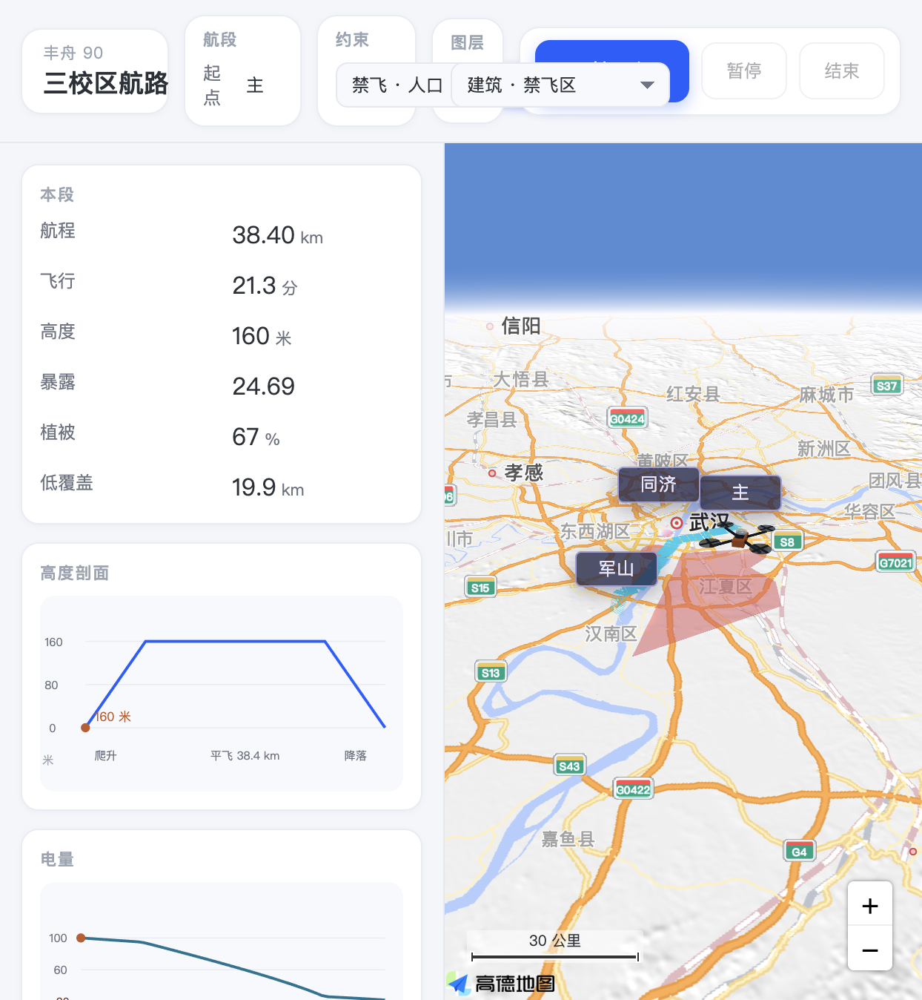
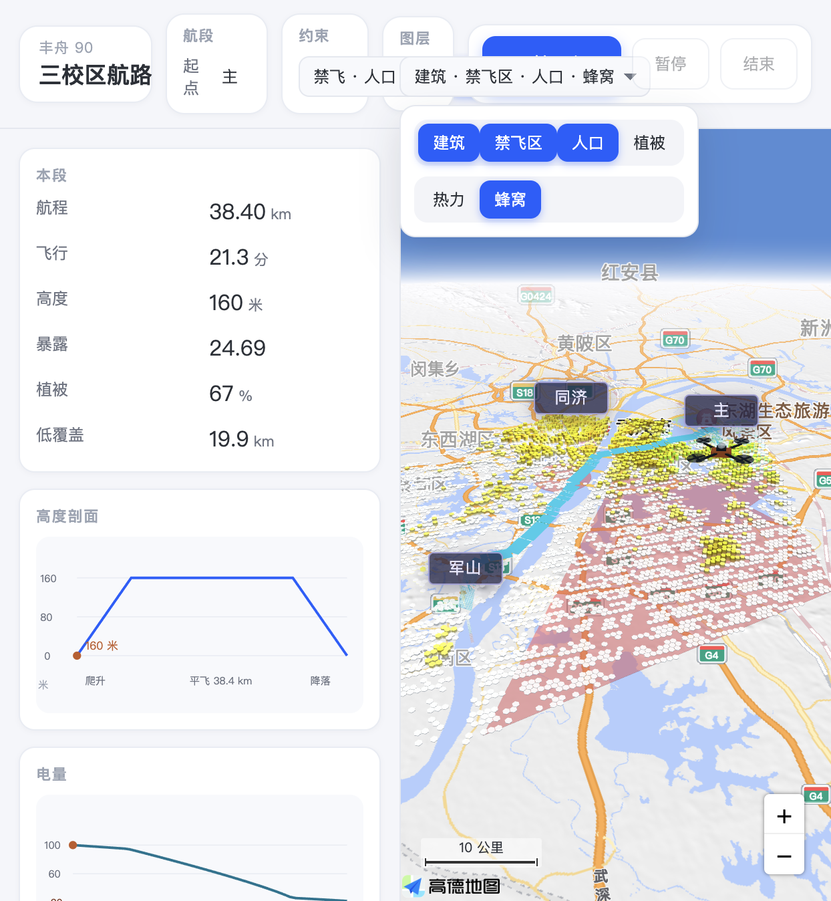
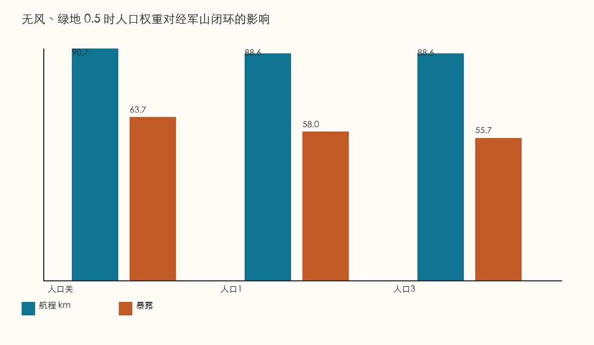
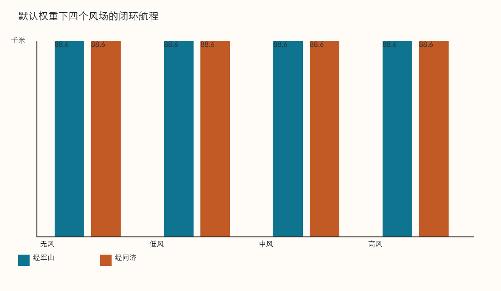
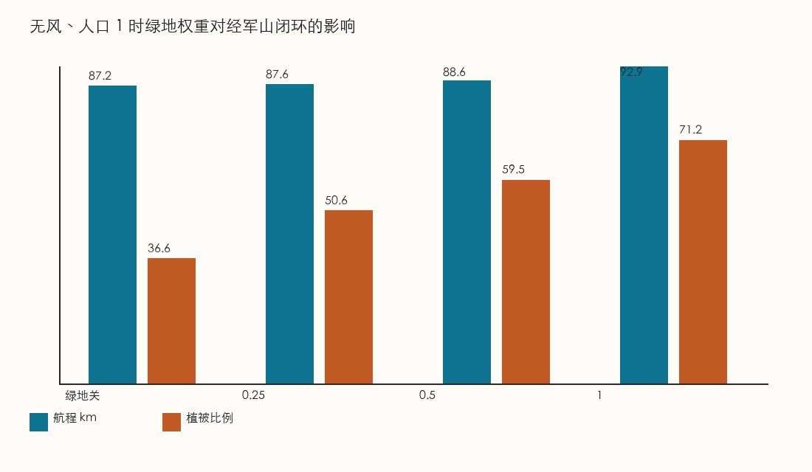

# 三校区低空航路规划与三维展示

华中科技大学主校区、军山校区、同济校区之间的**低空货运闭环航路**课程作业：在 100 m 空间图底上做可解释路径规划，并用高德三维地图播放航迹、图层与电量。

仓库地址：https://github.com/YJL-eic/campus-route-viewer

## 效果展示

三维展示界面：航段指标、高度剖面、电量曲线与高德地图立体航线。



打开人口蜂窝图层后的地图叠加效果。



约束开关对应的方案对比（人口权重、风场航程、绿地权衡）。

| 人口权衡 | 风场航程 | 绿地权衡 |
|---|---|---|
|  |  |  |

闭环航迹示意：


## 做什么

在禁飞、人口暴露、绿地偏好和风场约束下，预计算校区间有向航迹；前端按开关切换结果，演示垂直起降、巡航与补能过程。

| 模块 | 内容 |
|---|---|
| 规划 | 研究范围内 8 邻接有向图；禁飞硬约束；人口 / 绿地代价；风三角时间 |
| 机型 | 丰舟 90，巡航 30 m/s；两种工况：20 kg / 70 km、10 kg / 110 km |
| 运行假设 | 三校区均可补能，补能 30 分钟回满；可用航程按公布航程 × 0.8 |
| 展示 | React + Vite + 高德 JS API / Loca：立体航线、禁飞体、人口/植被热力与蜂窝、电量曲线与 20% 预警 |

默认空间方案：**禁飞开、人口开、绿地开、无风**。向北巡航高度 210 m，向南 160 m。

## 仓库结构

```
route_planner/          # Python：建图、代价、寻路、班次与导出
web/                    # React 三维展示（读取预计算结果）
outputs/                # 对比图、航段/班次指标、参数与局限说明
三校区100m空间数据交接包_绿地偏好_v5/   # 100 m 栅格与风场底座（只读）
使用说明.md             # 更细的本地操作说明
```

网页**不重新算路**，只播放 `web/public/data` 里已导出的航迹与图层。

## 快速开始

### 1. 环境

- Python 3 + `numpy`、`pillow`（见 `requirements.txt`）
- Node.js（跑前端）
- 高德开放平台 **Web 端（JS API）** Key 与安全密钥

```bash
python3 -m pip install -r requirements.txt
```

### 2. 配置高德密钥

```bash
cp web/.env.example web/.env.local
```

在 `web/.env.local` 填写：

```
VITE_AMAP_KEY=你的Key
VITE_AMAP_SECURITY=你的安全密钥
```

不要提交 `.env.local`。本地开发时域名白名单可留空；若部署到公网域名，须在高德控制台把该域名加入白名单。

### 3. 打开展示页

航迹已预计算，可直接启动：

```bash
cd web
npm install
npm run dev
```

浏览器打开终端给出的地址（一般为 `http://127.0.0.1:5173/`）。

### 4. （可选）重新算路

改权重、栅格或规则后，在仓库根目录执行：

```bash
python3 -m route_planner.run_all
```

会覆盖 `outputs/` 与 `web/public/data/`。算完刷新网页即可。

## 界面怎么用

1. **起点 / 终点**：选择校区后点「开始飞行」；可暂停、继续、结束。动画顺序：垂直爬升 → 平飞 → 垂直下降 → 示意补能回满。
2. **约束开关**：禁飞、人口、绿地、风场（低/中/高）各自对应一套预计算航迹；关掉禁飞仅作对照。
3. **载重方案**：切换 20 kg / 70 km 与 10 kg / 110 km；空间航迹相同，电量曲线不同，低于 20% 报警。
4. **图层**：禁飞区、人口/植被热力或蜂窝、城市三维等；图层不改变航线本身。
5. **起降场**：地图红点可点开示意终端空域（R25/R50、走廊与保护带），非实景测绘模型。

立体航线高度按约 30 倍夸张绘制，便于在城市尺度上分辨；面板数值仍是真实巡航高度（160 / 210 m）。

## 主要结果

| 位置 | 内容 |
|---|---|
| `outputs/figures/` | 闭环航迹与风场 / 人口 / 绿地权衡图 |
| `outputs/航段指标.csv` | 各开关组合下航程、时间、暴露等 |
| `outputs/班次指标.csv` | S0/S1/S2 完成率与准时率 |
| `outputs/参数表.md` / `局限说明.md` | 参数性质与不可写成实测的结论 |
| `web/public/data/` | 前端用的 GCJ-02 航迹、禁飞面、热力 PBF 等 |

## 说明与局限

本仓库是**课程方案与可视化**，不是可直接投入运行的空域审批系统。禁飞与建筑障碍为图底近似；补能时间、可用航程系数等为小组假设；人口、风场与绿地规则以交接包说明为准。详见 `缺少的数据.md` 与 `outputs/局限说明.md`。

## 许可与密钥

课程作业代码与导出结果可按小组约定使用。高德 Key 属个人/应用凭证，请各自申请，勿把真实密钥写入仓库或截图公开。
